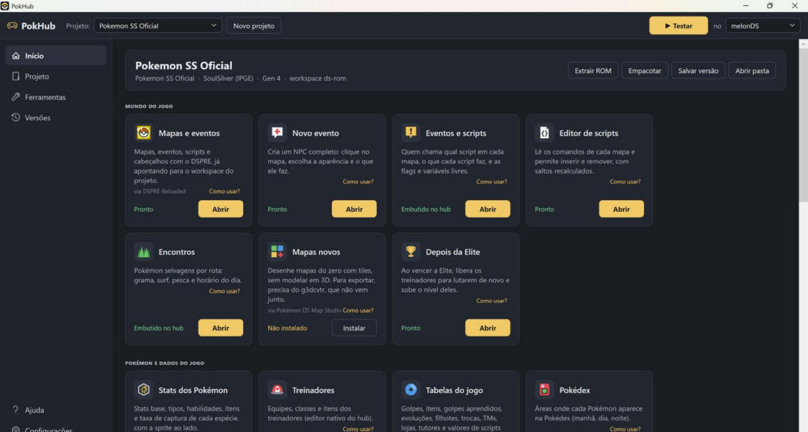
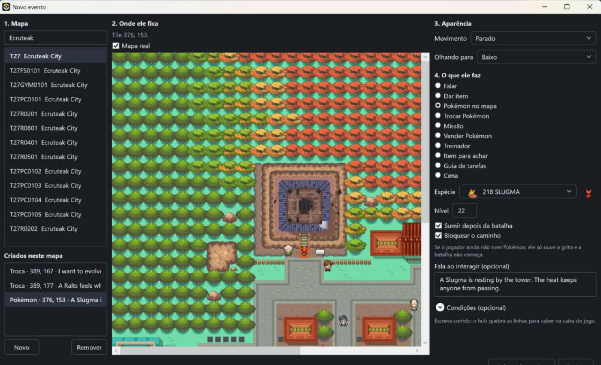
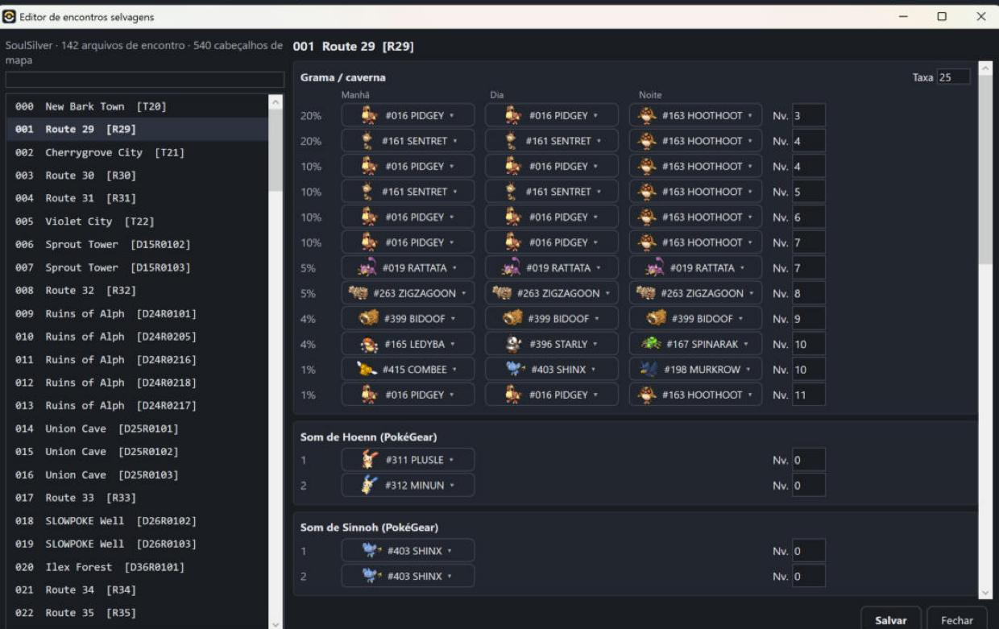

# PokHub

Hub para ROM hacking de Pokémon no Nintendo DS. Num lugar só, ele cria o projeto a partir da sua ROM, abre as ferramentas da comunidade apontando para esse projeto, edita os dados do jogo, guarda versões e gera a ROM e o patch para distribuir.

*English: a Windows hub for Nintendo DS Pokémon ROM hacking (Generation IV). It sets up a project from your own ROM, launches the community tools on it, edits game data directly, keeps versions, and builds the ROM and a BPS patch. The interface is available in Portuguese and English.*

> **Aviso.** O PokHub não vem com nenhum jogo, e não ajuda a conseguir um. Você precisa ter a sua própria cópia do jogo. Não é um produto da Nintendo, da Game Freak, da Creatures ou da The Pokémon Company, e não tem ligação com elas.



## O que dá para fazer

- **Projeto e versões:** extrair a ROM, salvar versões, ver o que mudou entre elas, voltar a uma versão anterior.
- **Testar:** gerar a ROM e abrir no emulador (melonDS ou DeSmuME) com um clique.
- **Distribuir:** gerar um patch BPS, para compartilhar o hack sem a ROM.
- **Editores próprios:** treinadores, encontros selvagens, textos (com prévia na fonte do jogo), stats dos Pokémon, tabelas do jogo, áreas da Pokédex e scripts.
- **Novo evento:** criar NPCs completos sem escrever script: falas, itens, trocas, missões, vendedores, treinadores, Pokémon parados no mapa e cenas.
- **Operações em lote:** níveis de selvagens e treinadores, IA, itens, experiência, com prévia antes de aplicar.
- **Injeção de código:** compilar e aplicar trechos em C no jogo, quando os dados não bastam.
- **Ferramentas da comunidade:** instalar e abrir DSPRE, PokEditor, NitroPaint, Tinke, Pokémon DS Map Studio, apicula, Randomizer ZX e as decomps da pret.
- **Agentes de IA:** um servidor MCP permite que um agente opere o hub (ver `docs/03-servidor-mcp.md`).
- **Ajuda:** guias passo a passo dentro do próprio hub.

Foco atual: Geração IV (Diamond, Pearl, Platinum, HeartGold e SoulSilver). A maior parte dos recursos foi feita e testada no HeartGold e SoulSilver em inglês.

| Novo evento, com o mapa real do jogo | Editor de encontros selvagens |
|---|---|
|  |  |

## Baixar

A versão pronta para Windows fica em [Releases](https://github.com/GuilhermeDorazzi/pok_hub/releases). Baixe o zip, extraia e abra o `PokeHub.exe`. Não precisa instalar o .NET.

## Requisitos

- Windows 10 ou 11
- .NET 9 SDK, só para compilar (a versão pronta já traz o .NET)
- A sua própria ROM de um jogo de Pokémon de Gen 4

## Como compilar

```
dotnet build PokeHub.sln
dotnet run --project src/PokeHub.App
```

Testes:

```
dotnet test tests/PokeHub.Core.Tests
```

## Estrutura

O projeto se chamava PokeHub. Por dentro, o código, os executáveis e a pasta de configuração (`%AppData%\PokeHub`) ainda usam esse nome, para não quebrar instalações e projetos já existentes.

```
src/PokeHub.Core   lógica: projetos, formatos do jogo, editores, patch, injeção de código
src/PokeHub.App    interface WPF
src/PokeHub.Mcp    servidor MCP para agentes de IA
plugins/*.json     manifestos das ferramentas que o hub instala
guides/*.json      guias mostrados na Ajuda
docs/              levantamento de ferramentas, arquitetura e servidor MCP
tests/             testes automáticos
```

## Licença e créditos

O PokHub é software livre, sob a GPL-3.0 (ver `LICENSE`). Ele usa dados e formatos do DSPRE (AGPL-3.0) e das decomps da pret, entre outros projetos. A lista completa, com a licença de cada um, está em [`THIRD_PARTY.md`](THIRD_PARTY.md).
